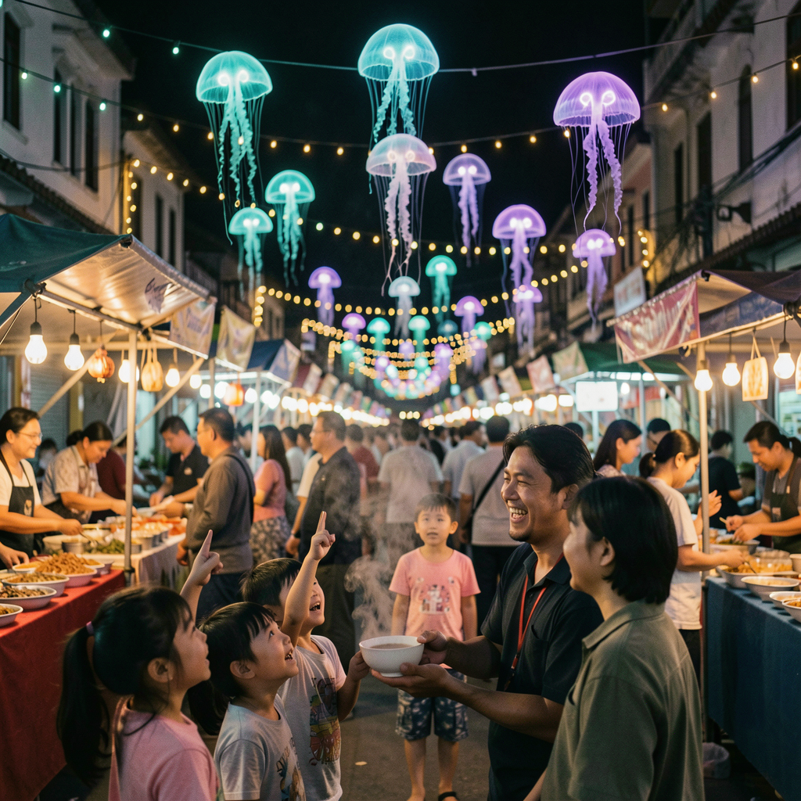
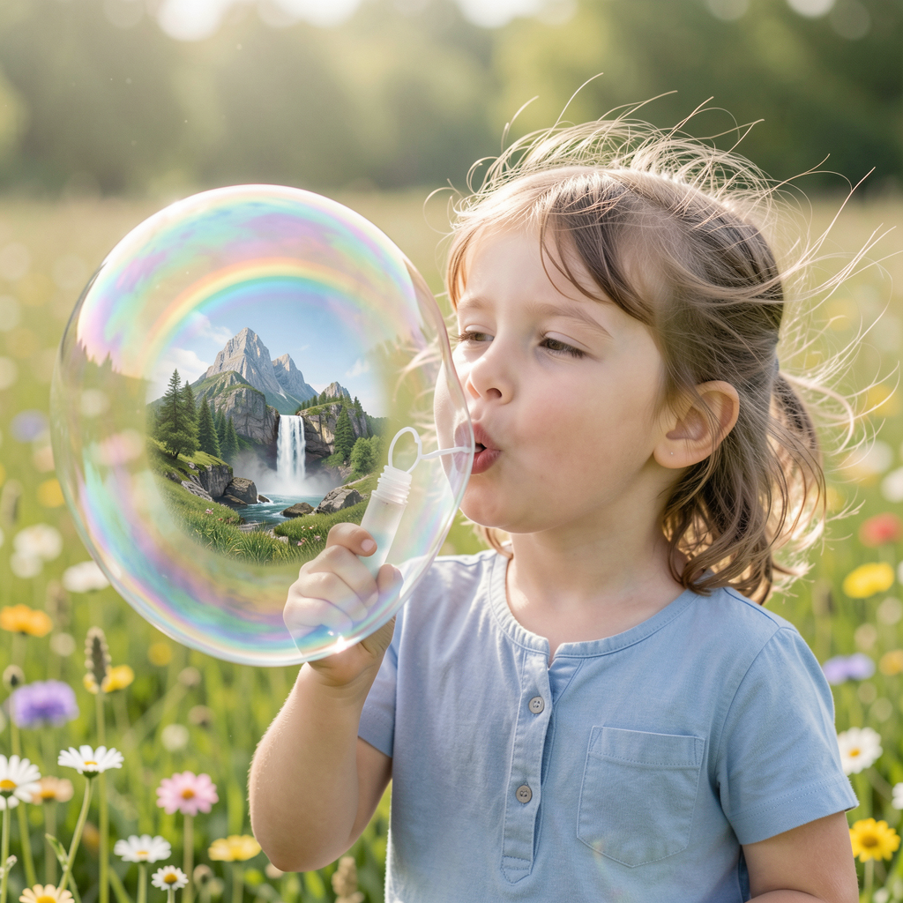
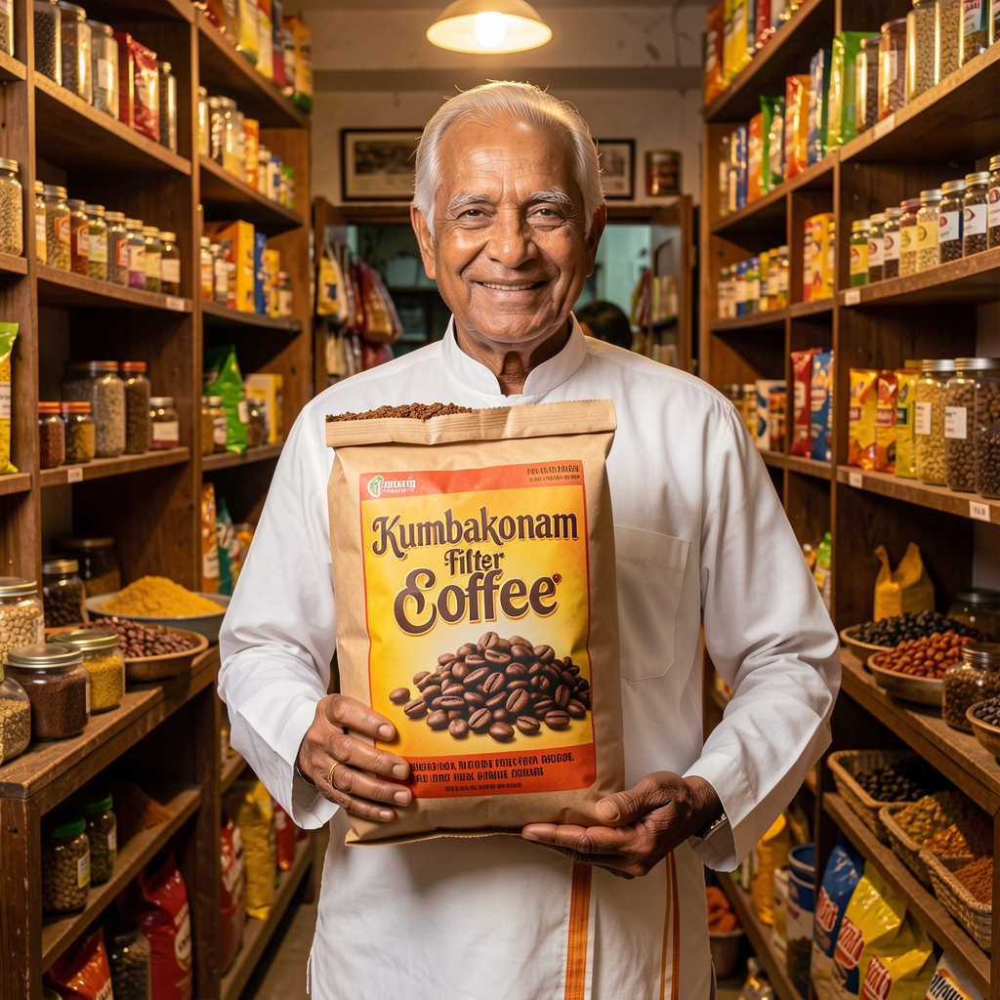
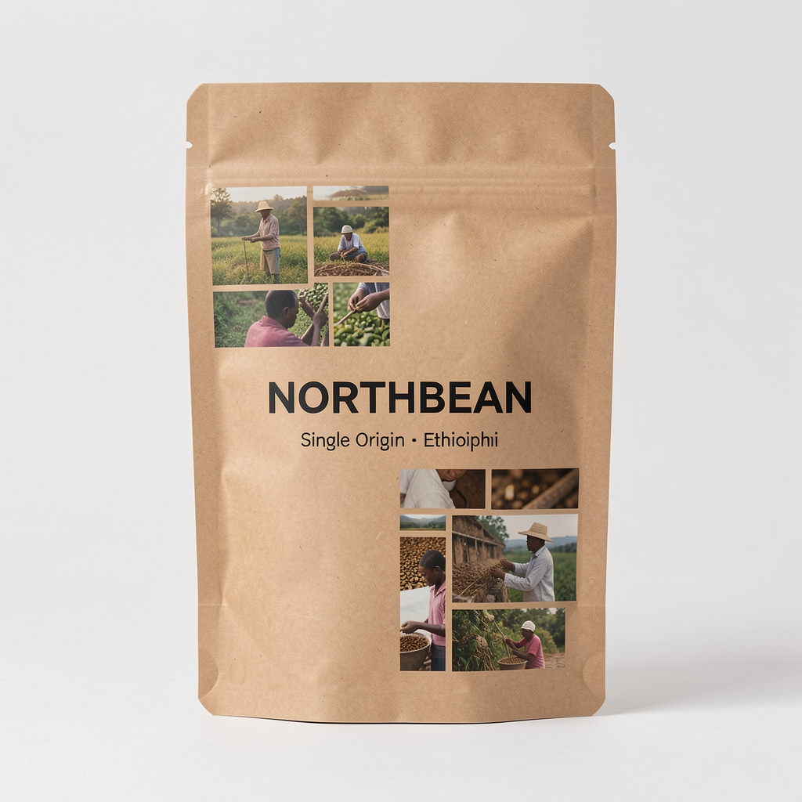
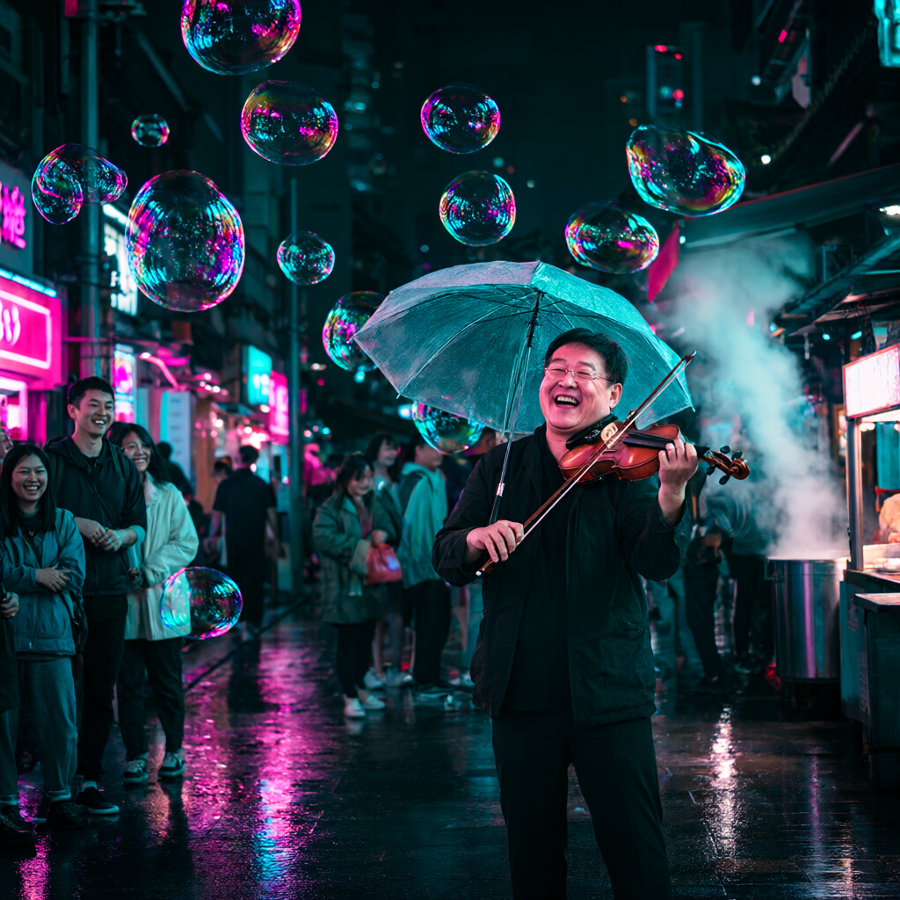
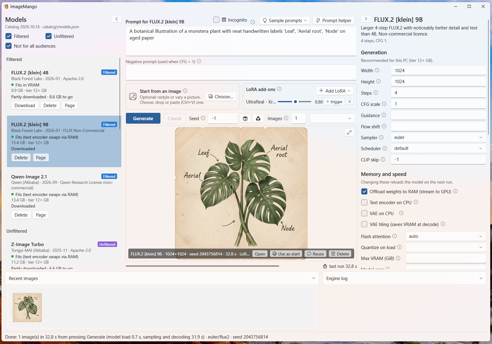
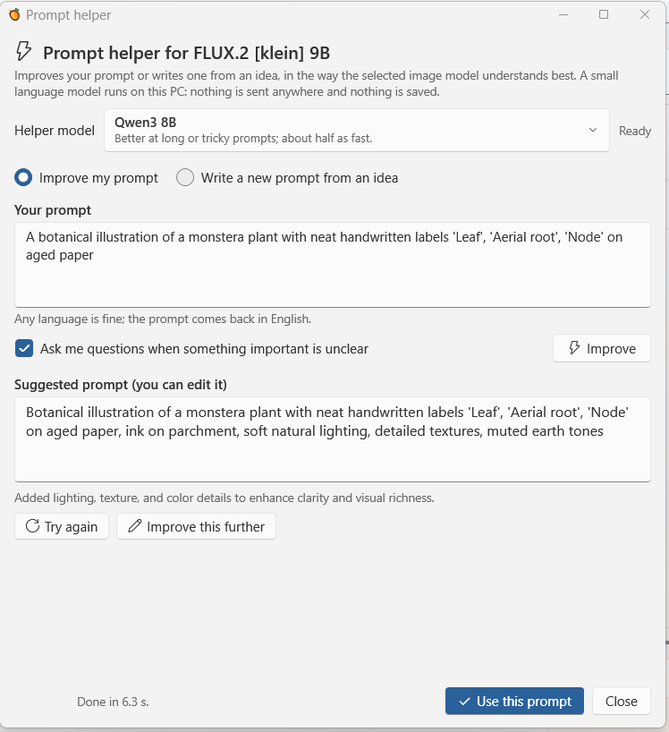

# ImageMango samples

A few images made with ImageMango, with the exact prompt, model and settings behind each one, so you can see what to
expect before you download anything. They are the best of a day's testing, but each one is straight out of the app:
no upscaling, retouching or cropping. Each PNG has a `.json` file next to it in [samples/](samples/) with the full record the app saves,
and the PNGs carry the same details inside them (Explorer › Properties › Details, or **Reuse** in the app).

All were made at 1024×1024 with the settings ImageMango recommends for the 12+ GB VRAM tier, weights offloaded to RAM. Times are for one image, from pressing **Generate**, with the model already loaded.

<table>
  <tr>
    <td><a href="#1-jellyfish-night-market"></a></td>
    <td><a href="#2-a-world-inside-a-bubble"></a></td>
    <td><a href="#3-village-in-a-teacup"></a></td>
    <td><a href="#4-caravan-under-a-ringed-planet"></a></td>
  </tr>
  <tr>
    <td><a href="#5-kumbakonam-filter-coffee"></a></td>
    <td><a href="#6-coffee-bag-mockup-image-to-image"></a></td>
    <td><a href="#7-violinist-in-the-rain-qwen-image-21"></a></td>
    <td></td>
  </tr>
</table>

## The app

The main window: models on the left, prompt, start image, LoRAs and preview in the middle, settings on the right.



The prompt helper, turning a short prompt into one the selected model understands better (Qwen3 8B, running locally).



## Models used

| Model | Files (from Hugging Face) | Licence |
| --- | --- | --- |
| **FLUX.2 [klein] 9B** (Black Forest Labs) | `flux-2-klein-9b-Q8_0.gguf` · text encoder `Qwen3-8B-Q4_K_M.gguf` · `flux2-vae.safetensors` | FLUX Non-Commercial |
| **Qwen-Image 2.1** (Qwen, Alibaba) | `qwen_image_2.1-Q8_0.gguf` · text encoder `Qwen3VL-8B-Instruct-Q4_K_M.gguf` · `qwen_image_2.1_vae_bf16.safetensors` | Qwen Research License (non-commercial) |

LoRA in samples 1–4: [UltraReal - Krea2, Klein9b](https://civitai.com/models/2462105?modelVersionId=3370879) at
weight 0.8 (you can find it with **Find LoRAs** in the app).

---

## 1. Jellyfish night market


```text
A bustling evening night market where glowing, translucent jellyfish float gently through the air like lanterns above the stalls, casting soft turquoise and violet light on happy shoppers below. A vendor hands a steaming bowl to a grinning customer, children pointing upward in wonder. Fairy-light strings, warm stall lighting mixed with cool bioluminescent glow, 35mm street photography style, realistic crowd and textures, magical but believable.
```

| Model | LoRA | Steps | CFG | Sampler / scheduler | Seed | Time |
| --- | --- | --- | --- | --- | --- | --- |
| FLUX.2 [klein] 9B | UltraReal 0.8 | 4 | 1 | euler / flux2 | 1704013839 | 30.8 s |

[Settings file](samples/20261016-170837-flux2-klein-9b-1704013839.json)

## 2. A world inside a bubble


```text
A delighted six-year-old girl blowing an enormous soap bubble in a sunlit meadow, and inside the bubble a tiny perfect world is visible: a miniature mountain, a waterfall and a rainbow. Her cheeks puffed out, wind-tossed hair, wildflowers around her. Bright spring morning, soft diffused light, 85mm lens at f/1.8, hyper-detailed bubble surface with swirling thin-film colours.
```

| Model | LoRA | Steps | CFG | Sampler / scheduler | Seed | Time |
| --- | --- | --- | --- | --- | --- | --- |
| FLUX.2 [klein] 9B | UltraReal 0.8 | 4 | 1 | euler / flux2 | 544913254 | 36.5 s |

[Settings file](samples/20261016-170743-flux2-klein-9b-544913254.json)

## 3. Village in a teacup


```text
Macro photograph of a miniature village built inside a vintage porcelain teacup, with tiny stone cottages, lit windows, moss-green hills and a little wooden bridge over a stream made of poured milk. Wisps of steam rising like clouds over the rooftops. A tiny hiker with a backpack walks up the rim. Warm kitchen morning light, extremely shallow depth of field, tilt-shift feel, fine ceramic crackle glaze texture.
```

| Model | LoRA | Steps | CFG | Sampler / scheduler | Seed | Time |
| --- | --- | --- | --- | --- | --- | --- |
| FLUX.2 [klein] 9B | UltraReal 0.8 | 4 | 1 | euler / flux2 | 1812217208 | 21.7 s |

[Settings file](samples/20261016-170953-flux2-klein-9b-1812217208.json)

## 4. Caravan under a ringed planet

A short prompt works too: FLUX.2 fills in a believable scene from one line.


```text
Cinematic wide shot of a desert caravan at dusk under a giant ringed planet, long shadows, volumetric dust, anamorphic flare
```

| Model | LoRA | Steps | CFG | Sampler / scheduler | Seed | Time |
| --- | --- | --- | --- | --- | --- | --- |
| FLUX.2 [klein] 9B | UltraReal 0.8 | 4 | 1 | euler / flux2 | 854395201 | 29.8 s |

[Settings file](samples/20261016-155257-flux2-klein-9b-854395201.json)

## 5. Kumbakonam filter coffee

Text on packaging. The large lettering comes out clean; the fine print on the packet is still gibberish, as with most
models today. The negative prompt was typed in but had no effect: it is only used when CFG is above 1, and FLUX.2
[klein] runs at CFG 1. Put "English text only" in the prompt itself instead.


```text
Traditional Tamil Nadu coffee powder packet with 'Kumbakonam filter Coffee' in bold traditional script, vibrant colors, kraft paper texture, studio lighting. An elderly man in veshti and white shirt holding the packet, smiling, standing in a Chennai street shop with wooden shelves and spices, warm golden light, detailed textures. show coffee beans in the packet cover. ensure all text are in english,
```

Negative prompt (ignored at CFG 1): `shop banners and name board are in english only. no non-english text anywhere`

| Model | LoRA | Steps | CFG | Sampler / scheduler | Seed | Time |
| --- | --- | --- | --- | --- | --- | --- |
| FLUX.2 [klein] 9B | none | 4 | 1 | euler / flux2 | 323687576 | 17.3 s |

[Settings file](samples/20261016-150242-flux2-klein-9b-323687576.json)

## 6. Coffee bag mockup (image-to-image)

Made from an earlier generation of a plain NORTHBEAN bag, using **Start from an image** at strength 0.6 and an extra
line in the prompt asking for the photo collage. The brand name is spot on; the smaller "Ethiopia" line picked up a
typo, so small text is worth checking (or regenerate with a new seed).


```text
Coffee bag packaging mockup with the brand 'NORTHBEAN' and 'Single Origin · Ethiopia' in clean sans-serif, kraft paper, studio light. add photograph collage of coffee estate and pluckers in the cover.
```

| Model | LoRA | Start image | Steps | CFG | Sampler / scheduler | Seed | Time |
| --- | --- | --- | --- | --- | --- | --- | --- |
| FLUX.2 [klein] 9B | none | strength 0.6 | 4 | 1 | euler / flux2 | 570793950 | 15.5 s |

[Settings file](samples/20261016-133803-flux2-klein-9b-570793950.json)

## 7. Violinist in the rain (Qwen-Image 2.1)

Qwen-Image is a full-step model: 30 steps at CFG 4, so it is about six times slower than FLUX.2 [klein] here, and it
uses the negative prompt. It is strong on lighting, reflections and crowds.


```text
A street violinist playing joyfully under a clear umbrella on a rain-soaked neon-lit alley at night, surrounded by giant iridescent soap bubbles floating in the air, each reflecting the pink and cyan lights. Passersby smiling and pausing to listen. Wet pavement mirror reflections, steam from a noodle stall, 85mm portrait lens, bokeh city lights, cinematic teal and magenta palette.
```

Negative prompt: `low quality, blurry, distorted text, watermark`

| Model | LoRA | Steps | CFG | Sampler / scheduler | Seed | Time |
| --- | --- | --- | --- | --- | --- | --- |
| Qwen-Image 2.1 | none | 30 | 4 | euler / flux | 1938005110 | 178.5 s |

[Settings file](samples/20261016-171608-qwen-image-2.1-1938005110.json)

---

## Make them yourself

Pick the model, paste the prompt, set the seed from the table (seed `-1` means random), and press **Ctrl+Enter**. With
the same model files, settings and seed you should get the same image or one very close to it; a different GPU backend
(CUDA, Vulkan, CPU) or engine version can shift small details. Back to the [README](README.md).
